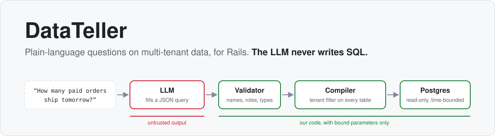

<p align="center">
  <picture>
    <source media="(prefers-color-scheme: dark)" srcset="docs/assets/banner-dark.svg">
    
  </picture>
</p>

<p align="center">
  <a href="https://github.com/SerylLns/data_teller/actions/workflows/ci.yml"></a>
  
  
  
  
  <a href="MIT-LICENSE"></a>
  <a href="https://dev.to/seryllns_/building-datateller-0-why-i-dont-let-an-llm-write-sql-2hjl"></a>
</p>

<p align="center">
  <a href="#why">Why</a> ·
  <a href="#how-it-works">How it works</a> ·
  <a href="#where-it-stands">Where it stands</a> ·
  <a href="#try-it-in-your-app">Try it</a> ·
  <a href="#security-model">Security model</a> ·
  <a href="#follow-the-build">Follow the build</a>
</p>

DataTeller is a mountable Rails engine for multi-tenant apps. Your users ask a question in their own words; an LLM turns it into a structured query, which is checked against what you declared, then compiled to ActiveRecord with the tenant filter added by the compiler, on every table.

> [!WARNING]
> **Early work in progress, not for production.** It answers questions through a minimal palette, with OpenAI only. There is no per-user limit yet, so anyone with access can spend your provider budget. It is not on RubyGems.

## Why

Letting a model write SQL makes tenant isolation an instruction in a prompt, and every query a piece of generated code that nobody reviewed. DataTeller takes the opposite approach: the model only picks names from a closed list, and everything that touches the database is our code.

| | Text-to-SQL | DataTeller |
|---|---|---|
| **Who writes the SQL** | The model | The compiler, from your declarations |
| **Tenant isolation** | A line in the prompt, or a check on SQL someone else wrote | A filter the compiler adds to every table it touches, checked before the query runs |
| **What a prompt injection gets** | Whatever SQL the checks miss | A query the user was allowed to ask anyway, or a refusal |
| **What the provider sees** | Depends on the tool: the schema, sometimes sample rows | The question, the date and the names this role may use. Never a row |
| **How you test it** | Read the queries it generated | `rake data_teller:isolation` traces every row read back to its tenant, on your own tables |
| **What it costs you** | Little setup | Declarations to write, and only the question shapes the format allows |

## How it works

The banner above is the whole pipeline, and only one step of it is the model's. Before that step, the role's catalog is narrowed to what the question needs (a router call above 12 datasets); after it, the JSON is validated against the role's permissions, compiled with bound parameters only, and run in a read-only transaction with a time budget. The answer is a table, with the dataset, metric and period it was read from.

Retrieval (RAG) and a written explanation of the answer are the plan, not built yet.

### One question, end to end

**"How many paid orders ship tomorrow?"** The LLM produces this:

```json
{
  "version": 1,
  "intent": "answer",
  "dataset": "orders",
  "metric": "count",
  "period": { "dimension": "ship_on", "range": { "relative": "tomorrow" } },
  "filters": [{ "segment": "paid" }]
}
```

And this is the SQL it runs on the dummy app (fake data), with comments added:

```sql
SELECT COUNT(*) AS c0 FROM "orders"
WHERE "orders"."status" = $1                                -- the "paid" segment, as you declared it
  AND "orders"."ship_on" >= $2 AND "orders"."ship_on" < $3  -- "tomorrow", in the tenant's time zone
  AND "orders"."account_id" = $4                            -- the tenant filter, added by the compiler
```

Every value is a bound parameter, and every column name comes from your declarations. The LLM can also ask for a clarification or say the question is out of scope, both from closed lists rather than in free text.

> [!NOTE]
> The question itself is sent to the provider as typed: if a user writes a customer's name in it, that name goes too.

## Where it stands

Built one decision at a time, each written down with the options rejected. The full plan is in [docs/ROADMAP.md](docs/ROADMAP.md).

- ✅ **The core, with no LLM in it.** Query format, declaration DSL checked at boot, validator, compiler with the tenant filter on every table, permissions by role on every use of a name, read-only execution with one time budget per question and an optional cost check, a read-only database role and row-level security, a minimum group size.
- ✅ **Tools to check it on your own data.** `rake data_teller:check`, the isolation kit, the cost report, the evaluation suite.
- ✅ **A first LLM integration.** OpenAI client, `DataTeller.ask`, a router for large catalogs, a minimal palette. **No per-user limit yet.**
- ⬜ **Next.** Prompt tuning, retrieval (RAG), filters on names, explanations, rate limits, a production UI.

### First measures

On fake data, with `gpt-6-luna` and a first prompt nobody has tuned yet:

| Questions, each asked in two languages | Answers right | Runs |
|---|---|---|
| Working set, 37 questions | **87.6%** on average | 5 |
| Separate set, the author's 10 questions | **70.0%** (14/20) | 1 |

- **The 87.6%** counts answers accepted after a review of the first run, which took that run from 79.7% to 85.1% ([ADR 0007](docs/adr/0007-catalog-narrowing.md), [ADR 0009](docs/adr/0009-baseline.md)).
- **The 70.0%** comes from one run, where one answer is worth 5 points, so the gap between the two numbers is a hint. These questions are never used for tuning, but they were seen during development, so this is not presented as an independent measure ([ADR 0006](docs/adr/0006-evaluation-dataset.md)).

Both say little until retrieval and tuning have something to compare to.

### Known gaps

- A filter on a name the user wrote ("orders from Alice") is refused: lookups are not implemented yet.
- Each question stands alone: "and in June?" after a first question does not work.
- With a soft-deleted parent, a total and its breakdown can disagree. The total keeps a row whose parent is deleted (who owns a row does not depend on a soft-delete), while a `group_by` through that parent leaves it out, since the parent's `default_scope` applies to the join. With `discard`, which has no `default_scope`, discarded rows are counted unless a segment leaves them out.

## Try it in your app

You need Ruby 3.2 or later, Rails 7.2.2.2 or later, and PostgreSQL. **PostgreSQL only:** the compiler uses `date_trunc` and `AT TIME ZONE`.

### 1. Install it from the repository

```ruby
gem "data_teller", github: "SerylLns/data_teller"
```

```bash
bin/rails generate data_teller:install
```

This writes `config/data_teller.rb`. The tenant is commented out on purpose, so **your app will not boot until you set it**: there is no safe default to guess.

```ruby
DataTeller.configure do |c|
  c.tenant do
    model Account
    resolve { |user| user.account }
  end
  c.roles { |user| user.roles }
  # Who is asking. The endpoint runs none of your filters, so it reads your authentication here. This line is for Devise.
  c.current_user { |request| request.env["warden"]&.user }
  c.llm = DataTeller::Providers::OpenAI.new(api_key: ENV.fetch("OPENAI_API_KEY"), model: "gpt-6-luna")
  c.expose Order, Customer
end
```

Without `c.current_user`, nobody has access. Without `c.llm`, questions are refused, and declarations and checks still work.

<details>
<summary>Optional: time zone and language</summary>

- `time_zone { |account| account.time_zone }` in `c.tenant` sets what "today" means for a tenant.
- `c.locale { |user| user.locale }` sets the language of the palette. English and French are included.

</details>

<details>
<summary>Optional: how heavy a question may be</summary>

```ruby
c.query_timeout = 5           # seconds for a whole question, every statement included (the default)
c.max_query_cost = 20_000     # an example, off by default: choose yours with rake data_teller:costs
```

`query_timeout` bounds a question, not each statement: a `compare` or a protected answer runs up to four, and they share the time. With `max_query_cost`, every statement of a question is planned with `EXPLAIN` before any runs, and a question whose estimated cost adds up to more is refused without reading a row. The cost is in the planner's units, which depend on your data and settings, so there is no default ([ADR 0013](docs/adr/0013-query-budget.md)).

</details>

### 2. Declare each exposed model, in one file per model

```ruby
# config/data_teller/orders.rb
DataTeller.refine Order do
  roles :admin, :support
  tenant_path :account

  metric :revenue, sum: :total_cents, format: :money, roles: :admin
  metric :avg_basket, ratio: %i[revenue count]

  dimension :ordered_at, time: true
  dimension :ship_on
  dimension :status

  segment :paid, where: { status: :paid }
end
```

A column that isn't declared can't be queried. A `count` metric exists on every dataset without being declared.

<details>
<summary>Optional: hide small groups from some roles</summary>

```ruby
# config/data_teller/customers.rb
DataTeller.refine Customer do
  roles :admin, :support
  tenant_path :account
  min_group_size 5, except: :admin

  dimension :acquisition_channel
end
```

On a dataset that describes people, a group of fewer than 5 rows is hidden from every role not named in `except:`, in any query that reads the dataset, joins included. The answer says how many groups were hidden, never which. A single number under 5 is refused, zero included: if 0 were shown, "hidden" would mean "at least one". `of: :customer` counts the distinct values of a direct `belongs_to` instead of rows, so that twelve orders from one customer count as one ([ADR 0012](docs/adr/0012-aggregate-disclosure.md)).

</details>

### 3. Check it

```bash
bin/rails data_teller:check                # in CI and after migrations: reads the tables and columns too
bin/rails "data_teller:schema[support]"    # the JSON schema this role would get
bin/rails "data_teller:catalog[support]"   # the same names, a few lines per dataset, for a person
bin/rails data_teller:isolation            # every row read traced back to its tenant, on this database's rows (TENANTS=12,57,301 CAP=5000)
bin/rails data_teller:costs                # each of those queries' estimated cost next to its real duration, to choose max_query_cost
bin/rails "data_teller:eval[dev]"          # score a model on eval/dev.yml (MODEL=perfect|replay|naive|routed, SAVE=1 to keep the run; naive and routed are paid calls)
```

An invalid configuration keeps the engine off, and by default the app refuses to boot. With `c.on_invalid_config = :disable`, the app boots without the engine and logs the error. The boot itself never reads the database, so it can't block a migration.

<details>
<summary>What the isolation kit and the cost report do</summary>

`data_teller:isolation` runs one query per declaration (each dimension, segment, metric path, and each filter compared to another tenant's value) as three tenants: by default the first two and the last one. It traces every row each query reads back to its owner through the `tenant_path` foreign keys, apart from the compiler, and exits 1 if a row belongs to another tenant or a table was read without a tenant filter. It only reads, in a transaction that is always rolled back, so you can point it at an anonymised copy of production; it prints dataset names and ids, never a value. A dataset no tenant read a row of is reported as not proved, not as passed ([ADR 0011](docs/adr/0011-isolation-kit.md)).

`data_teller:costs` runs the same queries, as the same tenants, with `EXPLAIN ANALYZE`, and prints each one's estimated cost next to how long it took, sorted by cost, with a line where your `max_query_cost` falls. Set the threshold below the costs where the durations take off, with a margin: these queries are simple, and real questions combine them. Unlike the kit, it runs every query for real, each under `query_timeout`: point it at a copy of production, not at the primary. It prints costs and durations, never a value.

</details>

### 4. Mount the engine and add the palette

```ruby
# config/routes.rb
mount DataTeller::Engine => "/data_teller"
```

```erb
<%# in your layout %>
<%= data_teller_palette %>
```

Ctrl/Cmd+K opens it. It renders nothing for someone the endpoint would refuse.

> [!IMPORTANT]
> Each question is a paid call to OpenAI.

For another interface, call the same path directly:

```ruby
outcome = DataTeller.ask("how many paid orders ship tomorrow?", user: current_user)
outcome.status          # :answered, :clarify, :out_of_scope or :refused
outcome.result&.columns # with outcome.result.rows, when answered
```

### 5. Recommended: limit the database role

`c.database_role` runs each query as a Postgres role that reads the declared columns only, and `c.row_security` keeps that role to the current tenant's rows. `rake data_teller:grants` prints the SQL, and `rake data_teller:check` verifies it.

## Security model

These are the rules the project is built around. **Only what is marked as enforced exists today.**

| Rule | State |
|---|---|
| Nothing is exposed unless it is declared | ✅ Enforced |
| Every dataset declares a path to the tenant, checked at boot | ✅ Enforced |
| The schema generated for the LLM only contains names the role can see | ✅ Enforced, but not a security boundary: the query validator re-checks everything |
| A resolver returning anything but the tenant model means no tenant | ✅ Enforced |
| A forbidden name and an unknown one get the same refusal | ✅ Enforced by the query validator |
| A permission applies to every use of a name: reading, filtering, grouping, ordering, and through paths, ratios and segments | ✅ Enforced |
| Values are bound parameters; column names come from declarations, never from the query | ✅ Enforced |
| The tenant filter is applied last, on every table touched, and checked before running | ✅ Enforced |
| A `scope:` used as a segment, and a `default_scope`, can only hold comparisons of the model's columns to plain values | ✅ Enforced: raw SQL, sub-queries, `from`, `joins` and the like are refused |
| Queries run in a read-only transaction, within one time budget per question, enforced by the database | ✅ Enforced |
| No row is sent to the LLM provider | ✅ Enforced by construction: what is sent is the question, the date and the role's declarations |
| No sentence shown to an end user comes from the LLM | ✅ Enforced: messages come from translations, and clarification options are names the validator checked |
| With `c.database_role`, queries run as a Postgres role that reads the declared columns only | 🔒 Opt-in, enforced by the database; checked by `rake data_teller:check` |
| With `c.row_security`, that role sees its tenant's rows only, even if the compiler's filter were gone | 🔒 Opt-in, enforced by the database; checked by `rake data_teller:check` |
| With `min_group_size`, a group of fewer than N rows, or N of a declared unit, is hidden from the roles not exempted, in any query that reads the dataset; a single value under N is refused | 🔒 Opt-in, per dataset |

Isolation is tested in `spec/security/` against hostile scopes and values, and on table shapes common in host apps (single table inheritance, soft-delete, nullable keys), on real rows across two tenants. That shows the cases tried, not all possible ones.

<details>
<summary>Known limits: what these rules do not cover</summary>

Some limits are known and won't go away. The boot checks that a `tenant_path` reaches the right model, not that it means the right thing, so that line has to be reviewed; the isolation kit follows the same path, so it cannot catch it either. Polymorphic associations can't be on a path yet, nor can a plain association that reads a polymorphic key without its type: give such a table its own tenant key. The check for sensitive column names is a lint, not a guarantee.

A minimum group size stops a role from reading a small group directly. It does not stop someone who sets out to cross-check answers ([ADR 0012](docs/adr/0012-aggregate-disclosure.md) D5):

- **Totals give a hidden group away.** The total minus the groups shown is the group hidden.
- **`min` and `max` return one row's value**, however large the group: give them to the exempt roles only, with a metric's `roles:`.
- **Dominance.** A group where one person makes most of the total gives that person's amount, roughly.
- **Differencing.** Two questions one person apart give that person's value. Only a rate limit and an audit trail, not built yet, make it slow and visible.
- **The threshold follows the datasets a query reads, not what a metric means.** A count of distinct customers on `orders` does not read `customers`, so the threshold of `customers` does not apply; declare one on `orders` too, with `of: :customer`.

It also has a cost. Counting distinct customers per group makes Postgres sort every joined row: on 500,000 orders grouped by a customer's city, about 1.8 s per query instead of 0.15 s, and the answer runs two queries. Counting a dataset's own rows stays fast.

</details>

## Development

You need PostgreSQL with the `vector`, `pg_trgm` and `unaccent` extensions. `docker compose up -d` starts a suitable database on port 5433; if you use it, set `PGHOST=127.0.0.1 PGPORT=5433 PGUSER=postgres PGPASSWORD=postgres`.

```bash
bundle install
RAILS_ENV=test bundle exec rails db:create db:schema:load
bundle exec rspec
bin/rubocop
```

`spec/dummy` is a small shop app (accounts, customers, products, orders, invoices, refunds, support tickets…) with **fake, deterministic seeds**, for development and tests only. To run a JSON query on them and see the SQL:

```bash
cd spec/dummy
bundle exec rails db:create db:migrate db:seed
bundle exec rake "try[Acme,admin]" QUERY='{"version":1,"intent":"answer","dataset":"orders","metric":"revenue"}'   # admin, support or member
```

To try the palette, with a fake sign-in that picks a seeded user. Each question is a paid call to OpenAI:

```bash
cd spec/dummy
OPENAI_API_KEY=... bin/rails server   # then open http://localhost:3000, sign in, and press Ctrl/Cmd+K
```

## Follow the build

I'm writing the build up as a series on dev.to, decisions and measures included: [part 0, why I don't let an LLM write SQL](https://dev.to/seryllns_/building-datateller-0-why-i-dont-let-an-llm-write-sql-2hjl).

<details>
<summary>The design decisions, each with the options rejected</summary>

| ADR | Decision |
|---|---|
| [0001](docs/adr/0001-query-ir.md) | Structured query format |
| [0002](docs/adr/0002-ui-delivery.md) | UI delivery: a command palette as a web component |
| [0003](docs/adr/0003-positioning-and-security-order.md) | Positioning, security additions and development order |
| [0004](docs/adr/0004-declaration-dsl.md) | Declaration DSL |
| [0005](docs/adr/0005-compiler.md) | Compiler: from a validated query to ActiveRecord |
| [0006](docs/adr/0006-evaluation-dataset.md) | Evaluation dataset: domain, languages, authorship |
| [0007](docs/adr/0007-catalog-narrowing.md) | Narrowing the catalog before the query |
| [0008](docs/adr/0008-llm-adapter.md) | The LLM adapter |
| [0009](docs/adr/0009-baseline.md) | The naive baseline: model and prompt |
| [0010](docs/adr/0010-ways-in.md) | The ways in: `DataTeller.ask`, the endpoint, the helper, and who is asking |
| [0011](docs/adr/0011-isolation-kit.md) | The isolation kit: proving tenant isolation on the integrator's own tables |
| [0012](docs/adr/0012-aggregate-disclosure.md) | Aggregate disclosure: a minimum group size per dataset |
| [0013](docs/adr/0013-query-budget.md) | The query budget: a time per question, and an optional cost estimate |

</details>

Found a security issue? Please don't open a public issue: see [SECURITY.md](SECURITY.md).

## License

[MIT](MIT-LICENSE)
