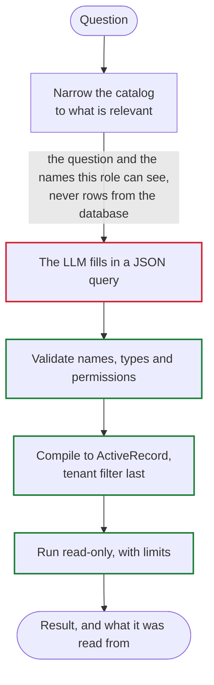

<h1 align="center">DataTeller</h1>

<p align="center">
  <strong>Your users ask questions about their own data in plain language.<br>The LLM never writes SQL.</strong>
</p>

<p align="center">
  <a href="https://github.com/SerylLns/data_teller/actions/workflows/ci.yml"></a>
  
  
  
  <a href="MIT-LICENSE"></a>
</p>

<p align="center">
  <a href="#how-it-works">How it works</a> ·
  <a href="#where-it-stands">Where it stands</a> ·
  <a href="#try-it-in-your-app">Try it</a> ·
  <a href="#security-model">Security model</a> ·
  <a href="#design-decisions">Design decisions</a>
</p>

A mountable Rails engine for multi-tenant apps. The LLM fills in a structured query, which is validated against what you declared, then compiled to ActiveRecord with the tenant filter added by the compiler.

> [!WARNING]
> **Early work in progress, not for production.** It answers questions through a minimal palette, with OpenAI only. There is no per-user limit yet, so anyone with access can spend your provider budget. It is not on RubyGems.

## How it works

Letting a model write SQL makes tenant isolation an instruction in a prompt, and every query a piece of generated code that nobody reviewed. DataTeller takes the opposite approach: the model only picks names from a closed list, and everything that touches the database is our code.



<sub>Red: untrusted output. Green: our code, from there on.</sub>

Retrieval (RAG) and a written explanation of the answer are the plan, not built yet. Today the role's whole catalog goes in the prompt (above 12 datasets, a router call narrows it first), and the answer is a table with the dataset, metric and period it was read from.

### One question, end to end

**"How many paid orders ship tomorrow?"** The LLM produces this:

```json
{
  "version": 1,
  "intent": "answer",
  "dataset": "orders",
  "metric": "count",
  "period": { "dimension": "ship_on", "range": { "relative": "tomorrow" } },
  "filters": [{ "segment": "paid" }]
}
```

And this is the SQL it runs on the dummy app (fake data), with comments added:

```sql
SELECT COUNT(*) AS c0 FROM "orders"
WHERE "orders"."status" = $1                                -- the "paid" segment, as you declared it
  AND "orders"."ship_on" >= $2 AND "orders"."ship_on" < $3  -- "tomorrow", in the tenant's time zone
  AND "orders"."account_id" = $4                            -- the tenant filter, added by the compiler
```

Every value is a bound parameter, and every column name comes from your declarations. The LLM can also ask for a clarification or say the question is out of scope, both from closed lists rather than in free text.

> [!NOTE]
> The question itself is sent to the provider as typed: if a user writes a customer's name in it, that name goes too.

## Where it stands

| Piece | State |
|---|---|
| Query format (JSON Schema), declaration DSL, tenant declaration | ✅ Done |
| Boot validation, `rake data_teller:check` | ✅ Done |
| Per-role catalog, schema generated for the LLM | ✅ Done |
| Query validator, permissions by role on every use of a name | ✅ Done |
| Compiler, tenant filter on every table, period comparison (`compare`) | ✅ Done |
| Execution guards: read-only transaction, statement timeout, row and group caps | ✅ Done |
| Read-only database role limited to the declared columns, Postgres row-level security | ✅ Done |
| Evaluation suite, `rake data_teller:eval` | ✅ Done |
| LLM client (OpenAI), `DataTeller.ask`, a router for large catalogs | ✅ Done |
| Minimal palette and endpoint, **not for production yet: no per-user limit** | ✅ Done |
| Minimum group size, complexity budget, security test kit | ⏳ Next |
| Prompt tuning, retrieval (RAG), explanations, production UI | ⬜ Not started |

### First measures

On fake data, with `gpt-6-luna` and a first prompt nobody has tuned yet:

| Questions, each asked in two languages | Answers right | Runs |
|---|---|---|
| Working set, 37 questions | **87.6%** on average | 5 |
| Separate set, the author's 10 questions | **70.0%** (14/20) | 1 |

- **The 87.6%** counts answers accepted after a review of the first run, which took that run from 79.7% to 85.1% ([ADR 0007](docs/adr/0007-catalog-narrowing.md), [ADR 0009](docs/adr/0009-baseline.md)).
- **The 70.0%** comes from one run, where one answer is worth 5 points, so the gap between the two numbers is a hint. These questions are never used for tuning, but they were seen during development, so this is not presented as an independent measure ([ADR 0006](docs/adr/0006-evaluation-dataset.md)).

Both say little until retrieval and tuning have something to compare to. The full plan is in [docs/ROADMAP.md](docs/ROADMAP.md).

### Known gaps

- A filter on a name the user wrote ("orders from Alice") is refused: lookups are not implemented yet.
- Each question stands alone: "and in June?" after a first question does not work.

## Try it in your app

You need Ruby 3.2 or later, Rails 7.2.2.2 or later, and PostgreSQL. **PostgreSQL only:** the compiler uses `date_trunc` and `AT TIME ZONE`.

### 1. Install it from the repository

```ruby
gem "data_teller", github: "SerylLns/data_teller"
```

```bash
bin/rails generate data_teller:install
```

This writes `config/data_teller.rb`. The tenant is commented out on purpose, so **your app will not boot until you set it**: there is no safe default to guess.

```ruby
DataTeller.configure do |c|
  c.tenant do
    model Account
    resolve { |user| user.account }
  end
  c.roles { |user| user.roles }
  # Who is asking. The endpoint runs none of your filters, so it reads your authentication here. This line is for Devise.
  c.current_user { |request| request.env["warden"]&.user }
  c.llm = DataTeller::Providers::OpenAI.new(api_key: ENV.fetch("OPENAI_API_KEY"), model: "gpt-6-luna")
  c.expose Order, Customer
end
```

Without `c.current_user`, nobody has access. Without `c.llm`, questions are refused, and declarations and checks still work.

<details>
<summary>Optional: time zone and language</summary>

- `time_zone { |account| account.time_zone }` in `c.tenant` sets what "today" means for a tenant.
- `c.locale { |user| user.locale }` sets the language of the palette. English and French are included.

</details>

### 2. Declare each exposed model, in one file per model

```ruby
# config/data_teller/orders.rb
DataTeller.refine Order do
  roles :admin, :support
  tenant_path :account

  metric :revenue, sum: :total_cents, format: :money, roles: :admin
  metric :avg_basket, ratio: %i[revenue count]

  dimension :ordered_at, time: true
  dimension :ship_on
  dimension :status

  segment :paid, where: { status: :paid }
end
```

A column that isn't declared can't be queried. A `count` metric exists on every dataset without being declared.

### 3. Check it

```bash
bin/rails data_teller:check                # in CI and after migrations: reads the tables and columns too
bin/rails "data_teller:schema[support]"    # the JSON schema this role would get
bin/rails "data_teller:catalog[support]"   # the same names, a few lines per dataset, for a person
bin/rails "data_teller:eval[dev]"          # score a model on eval/dev.yml (MODEL=perfect|replay|naive|routed, SAVE=1 to keep the run; naive and routed are paid calls)
```

An invalid configuration keeps the engine off, and by default the app refuses to boot. With `c.on_invalid_config = :disable`, the app boots without the engine and logs the error. The boot itself never reads the database, so it can't block a migration.

### 4. Mount the engine and add the palette

```ruby
# config/routes.rb
mount DataTeller::Engine => "/data_teller"
```

```erb
<%# in your layout %>
<%= data_teller_palette %>
```

Ctrl/Cmd+K opens it. It renders nothing for someone the endpoint would refuse.

> [!IMPORTANT]
> Each question is a paid call to OpenAI.

For another interface, call the same path directly:

```ruby
outcome = DataTeller.ask("how many paid orders ship tomorrow?", user: current_user)
outcome.status          # :answered, :clarify, :out_of_scope or :refused
outcome.result&.columns # with outcome.result.rows, when answered
```

### 5. Recommended: limit the database role

`c.database_role` runs each query as a Postgres role that reads the declared columns only, and `c.row_security` keeps that role to the current tenant's rows. `rake data_teller:grants` prints the SQL, and `rake data_teller:check` verifies it.

## Security model

These are the rules the project is built around. **Only what is marked as enforced exists today.**

| Rule | State |
|---|---|
| Nothing is exposed unless it is declared | ✅ Enforced |
| Every dataset declares a path to the tenant, checked at boot | ✅ Enforced |
| The schema generated for the LLM only contains names the role can see | ✅ Enforced, but not a security boundary: the query validator re-checks everything |
| A resolver returning anything but the tenant model means no tenant | ✅ Enforced |
| A forbidden name and an unknown one get the same refusal | ✅ Enforced by the query validator |
| A permission applies to every use of a name: reading, filtering, grouping, ordering, and through paths, ratios and segments | ✅ Enforced |
| Values are bound parameters; column names come from declarations, never from the query | ✅ Enforced |
| The tenant filter is applied last, on every table touched, and checked before running | ✅ Enforced |
| A `scope:` used as a segment, and a `default_scope`, can only hold comparisons of the model's columns to plain values | ✅ Enforced: raw SQL, sub-queries, `from`, `joins` and the like are refused |
| Queries run in a read-only transaction with a timeout, enforced by the database | ✅ Enforced |
| No row is sent to the LLM provider | ✅ Enforced by construction: what is sent is the question, the date and the role's declarations |
| No sentence shown to an end user comes from the LLM | ✅ Enforced: messages come from translations, and clarification options are names the validator checked |
| With `c.database_role`, queries run as a Postgres role that reads the declared columns only | 🔒 Opt-in, enforced by the database; checked by `rake data_teller:check` |
| With `c.row_security`, that role sees its tenant's rows only, even if the compiler's filter were gone | 🔒 Opt-in, enforced by the database; checked by `rake data_teller:check` |
| Minimum group size | 🗓️ Planned |

Isolation is tested in `spec/security/` against hostile scopes and values, on real rows across two tenants. That shows the cases tried, not all possible ones.

Some limits are known and won't go away. The boot checks that a `tenant_path` reaches the right model, not that it means the right thing, so that line has to be reviewed. The check for sensitive column names is a lint, not a guarantee.

## Development

You need PostgreSQL with the `vector`, `pg_trgm` and `unaccent` extensions. `docker compose up -d` starts a suitable database on port 5433; if you use it, set `PGHOST=127.0.0.1 PGPORT=5433 PGUSER=postgres PGPASSWORD=postgres`.

```bash
bundle install
RAILS_ENV=test bundle exec rails db:create db:schema:load
bundle exec rspec
bin/rubocop
```

`spec/dummy` is a small shop app (accounts, customers, products, orders) with **fake, deterministic seeds**, for development and tests only. To run a JSON query on them and see the SQL:

```bash
cd spec/dummy
bundle exec rails db:create db:migrate db:seed
bundle exec rake "try[Acme,admin]" QUERY='{"version":1,"intent":"answer","dataset":"orders","metric":"revenue"}'   # admin, support or member
```

To try the palette, with a fake sign-in that picks a seeded user. Each question is a paid call to OpenAI:

```bash
cd spec/dummy
OPENAI_API_KEY=... bin/rails server   # then open http://localhost:3000, sign in, and press Ctrl/Cmd+K
```

## Design decisions

Each decision is written down with the options that were rejected:

| ADR | Decision |
|---|---|
| [0001](docs/adr/0001-query-ir.md) | Structured query format |
| [0002](docs/adr/0002-ui-delivery.md) | UI delivery: a command palette as a web component |
| [0003](docs/adr/0003-positioning-and-security-order.md) | Positioning, security additions and development order |
| [0004](docs/adr/0004-declaration-dsl.md) | Declaration DSL |
| [0005](docs/adr/0005-compiler.md) | Compiler: from a validated query to ActiveRecord |
| [0006](docs/adr/0006-evaluation-dataset.md) | Evaluation dataset: domain, languages, authorship |
| [0007](docs/adr/0007-catalog-narrowing.md) | Narrowing the catalog before the query |
| [0008](docs/adr/0008-llm-adapter.md) | The LLM adapter |
| [0009](docs/adr/0009-baseline.md) | The naive baseline: model and prompt |
| [0010](docs/adr/0010-ways-in.md) | The ways in: `DataTeller.ask`, the endpoint, the helper, and who is asking |

## License

[MIT](MIT-LICENSE)
