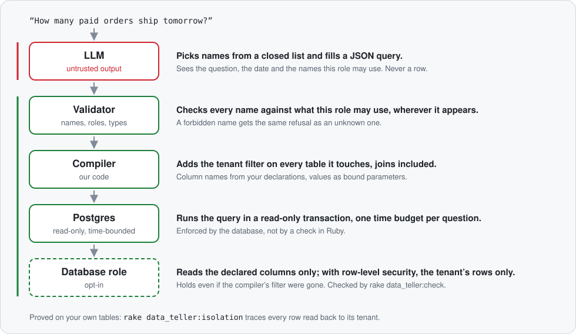

# Security model

  <picture>
    <source media="(prefers-color-scheme: dark)" srcset="assets/security-layers-dark.svg">
    
  </picture>

Found a security issue? Please don't open a public issue: see [SECURITY.md](../SECURITY.md).

## The rules, layer by layer

Every rule below is enforced today, except the three marked 🔒, which you turn on.

**What can be asked at all**
- Nothing is exposed unless it is declared.
- Every dataset declares a path to the tenant, checked at boot.
- A resolver returning anything but the tenant model means no tenant.

**The LLM**
- No row is sent to the provider, by construction: what is sent is the question, the date and the role's declarations.
- The schema it gets only contains names the role can see. That is not a security boundary: the validator checks everything again.
- No sentence shown to an end user comes from it: messages come from translations, and clarification options are names the validator checked.

**The validator**
- A forbidden name and an unknown one get the same refusal.
- A permission applies to every use of a name: reading, filtering, grouping, ordering, and through paths, ratios and segments.
- A list shows rows only on a dataset that declares `list`, never on one a minimum group size protects for the role. The cursor of its next page is checked like the model's output.

**The compiler**
- Values are bound parameters; column names come from declarations, never from the query.
- The tenant filter is applied last, on every table touched, and checked before running.
- A `scope:` used as a segment, and a `default_scope`, can only compare the model's columns to plain values: raw SQL, sub-queries, `from`, `joins` and the like are refused.

**Postgres**
- Queries run in a read-only transaction, within one time budget per question, enforced by the database.
- 🔒 With `c.database_role`, they run as a role that reads the declared columns only.
- 🔒 With `c.row_security`, that role sees its tenant's rows only, even if the compiler's filter were gone. `rake data_teller:check` verifies both.

**The answer**
- 🔒 With `min_group_size`, a group of fewer than N rows, or N of a declared unit, is hidden from the roles not exempted, in any query that reads the dataset; a single value under N is refused.

## How it is tested

Isolation is tested in `spec/security/` against hostile scopes and values, and on table shapes common in host apps (single table inheritance, soft-delete, nullable keys), on real rows across two tenants. That shows the cases tried, not all possible ones.

`rake data_teller:isolation` runs the same kind of proof on your own tables: see [Configuration and checks](configuration.md#checks-the-rake-tasks-the-isolation-kit-and-the-cost-report).

## What these rules do not cover

Some limits are known and won't go away. The boot checks that a `tenant_path` reaches the right model, not that it means the right thing, so that line has to be reviewed; the isolation kit follows the same path, so it cannot catch it either. Polymorphic associations can't be on a path yet, nor can a plain association that reads a polymorphic key without its type: give such a table its own tenant key. The check for sensitive column names is a lint, not a guarantee.

A minimum group size stops a role from reading a small group directly. It does not stop someone who sets out to cross-check answers ([ADR 0012](adr/0012-aggregate-disclosure.md) D5):

- **Totals give a hidden group away.** The total minus the groups shown is the group hidden.
- **`min` and `max` return one row's value**, however large the group: give them to the exempt roles only, with a metric's `roles:`.
- **Dominance.** A group where one person makes most of the total gives that person's amount, roughly.
- **Differencing.** Two questions one person apart give that person's value. Only a rate limit and an audit trail, not built yet, make it slow and visible.
- **The threshold follows the datasets a query reads, not what a metric means.** A count of distinct customers on `orders` does not read `customers`, so the threshold of `customers` does not apply; declare one on `orders` too, with `of: :customer`.

It also has a cost. Counting distinct customers per group makes Postgres sort every joined row: on 500,000 orders grouped by a customer's city, about 1.8 s per query instead of 0.15 s, and the answer runs two queries. Counting a dataset's own rows stays fast.
